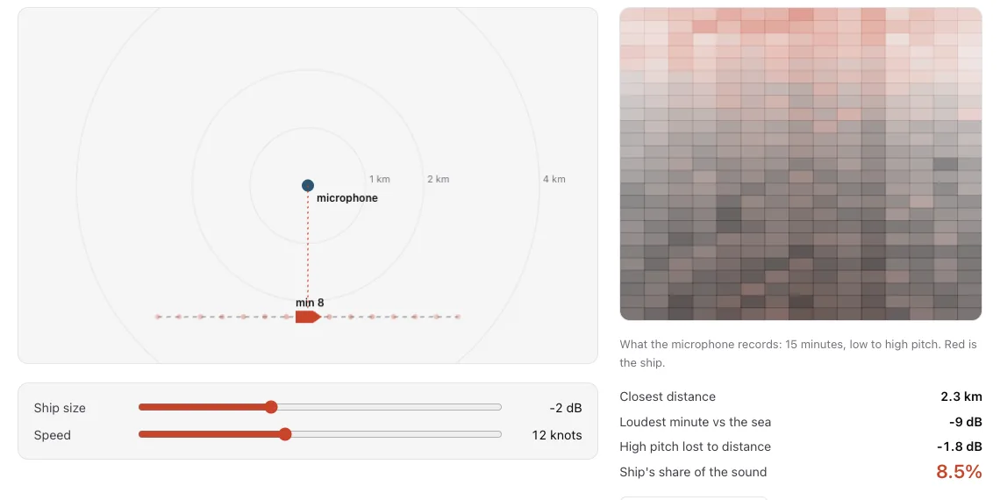
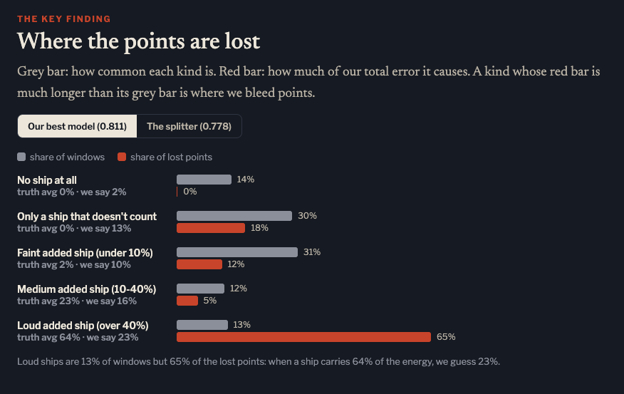

# Listening for ships

Estimating how much of an underwater recording's energy comes from a passing ship, for the Zindi underwater vessel noise challenge.

<a href="https://godsonntungi.github.io/#lab">
  <picture>
    <source media="(prefers-color-scheme: dark)" srcset="docs/ships-dark.webp">
    
  </picture>
</a>

**Try it live:** https://godsonntungi.github.io/#lab (the live widget uses a generated sea, not real recordings)

## The problem

Hydrophones off South Africa record the sea. Each 15-minute window comes as a grid of loudness, 15 minutes by 25 pitch bands, with no audio. The organisers mixed recorded ships into some windows, and you predict what fraction of each window's energy is the added ship.

## What I built

Nobody labelled the real recordings, so I made my own practice data the same way the organisers did: real South African background plus a ship from VTUAD (a free Ocean Networks Canada library), mixed at a loudness I chose. Every mix comes with the right answer.

On that data I built:

- **A splitter** that breaks each window into a ship part and a sea part, using sound shapes learned from ship-only and sea-only recordings.
- **A tree model** (LightGBM) trained on mixes built many different ways, with the splitter's output as extra inputs. My best.
- **A local grader** that ranks methods the way the public leaderboard does, so ideas could be tested without spending submissions.

## Where the points go

Every window is one of five kinds: no ship, a ship that does not count, or a faint, medium or loud added ship. The hard one is the ship that was already in the recording. It sounds like a ship but does not count.

Loud ships cost the most. When an added ship carries over 40% of the energy, the model guesses about 23% instead of the true 64%. Those windows are 13% of the data but **65% of the lost points**.



The reason: a loud ship that counts and a loud ship that was already there look the same to the model, so it guesses in the middle. These numbers come from 15,000 practice windows I built myself, not competition test data.

## Results

| Method | Public score |
|---|---|
| Organisers' starter model | 0.754 |
| Splitter | 0.778 |
| Tree model, my best | **0.811** |
| First place | 0.905 |

Higher is better. I tested several ideas about how the hidden answers were built against the leaderboard; none closed the 0.094 gap. My best model guesses the right overall level but ranks windows poorly, so the missing piece is telling counted ships from uncounted ones.

## How the code is laid out

```
src/
  sa_windows.py     cut the South African recordings into 15-minute windows
  vtuad_bands.py    stream VTUAD ship clips and keep only 25-band power
  mix.py            build labelled practice windows (background + ship at a known share)
  features.py       per-window features
  nmf.py, floor.py  the splitter and its quiet-floor cap
  train.py          first tree model with grouped cross-validation
  v8.py             best tree model (local test, or full training + submission)
  net.py            small neural net on the raw grid (tested, not better)
  lbcheck.py        rebuild each method on a held-out split for fair comparison
  score_local.py    local grader that ranks methods like the leaderboard
  examtest.py       checks a local grader can predict new scores, not just old ones
  breakdown.py      fills viz/breakdown_template.html into viz/breakdown.html
  listen.py         fills viz/listen_template.html into viz/listen.html
  the rest          one-off experiments testing ideas about the hidden answers
scripts/            helpers to build frozen test sets and score saved models
viz/                overview and share pages (generated sea), templates for the rest
docs/               images for this README
```

## How to reproduce

1. Get the data from the official Zindi competition page, listed at https://zindi.africa/competitions (not included here). Put `Test.csv` in `data/` and unzip the South African recordings into `data/sa/`.
2. Install the packages: `pip install -r requirements.txt` (Python 3.10+).
3. Build background windows: `python3 src/sa_windows.py`.
4. Download and reduce the VTUAD ship clips (several GB, streamed): `python3 src/vtuad_bands.py`. Also needs `data/vtuad/registry_anonymized.csv` from the VTUAD release.
5. Check the model locally: `python3 src/v8.py local`.
6. Train on everything and write a submission: `python3 src/v8.py submit`.

Run everything from the repo root. `data/`, `models/` and `submissions/` are created locally and ignored by git.

## Licence

MIT, see [LICENSE](LICENSE). The competition data is not included and is not covered by this licence.
